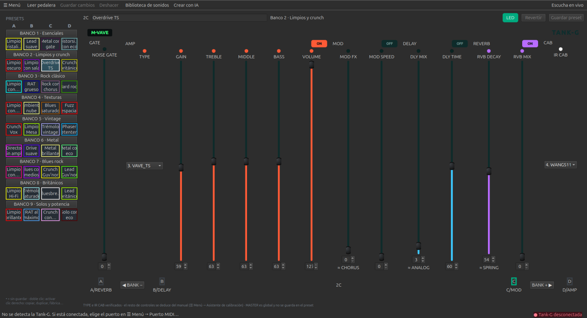
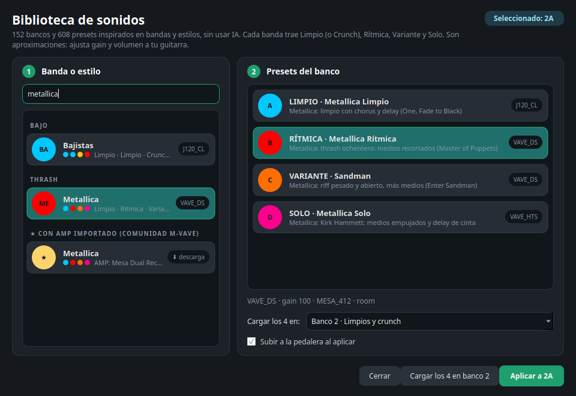
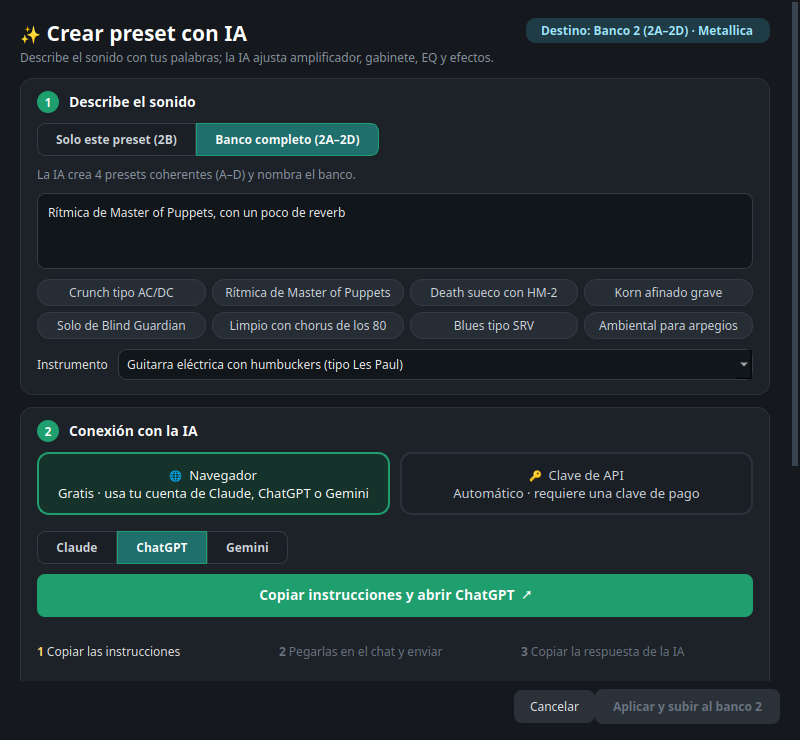
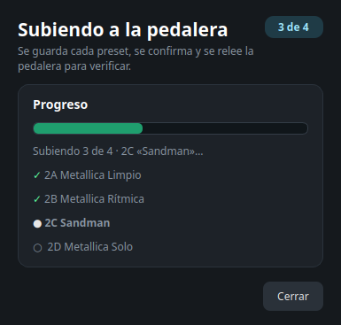
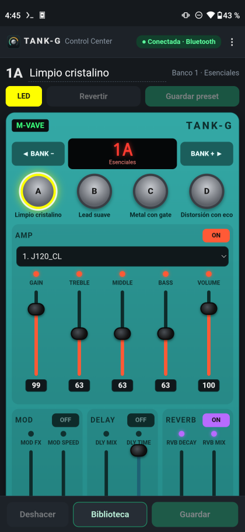
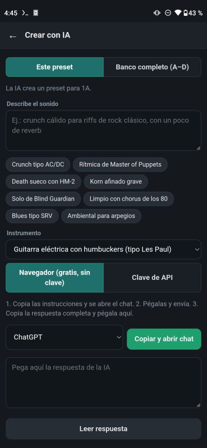
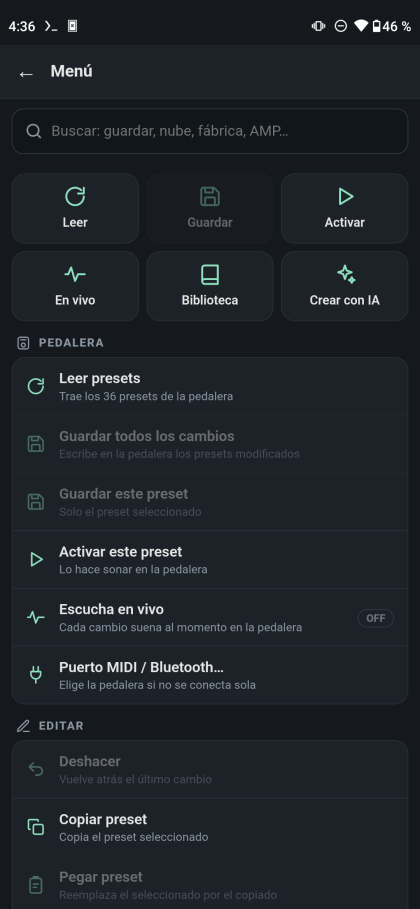
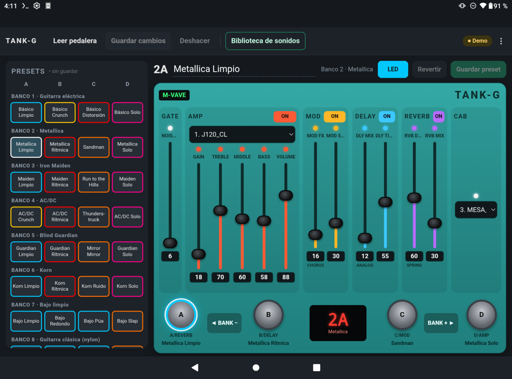

# Tank-G Control Center

Gestor de presets para la pedalera **M-VAVE Tank-G** en **Windows, Linux y Android** (teléfono y
tablet). Habla el protocolo del editor oficial M-EFCS directamente por **USB-MIDI** (la pedalera es
class-compliant: no necesita drivers) y, en la Tank-G v2, por **Bluetooth**.

<p align="center">
  
  &nbsp;
  
</p>

| Biblioteca de sonidos | Crear con IA | Subida con verificación |
|---|---|---|
|  |  |  |

| Android: pedalera | Biblioteca | Crear con IA | Menú |
|---|---|---|---|
|  |  |  |  |



- Linux: ALSA rawmidi (`/dev/snd/midiC*D0`), sin dependencias MIDI; Bluetooth con BlueZ.
- Windows: `python-rtmidi` y Bluetooth con WinRT (se instalan solos).
- Android 6+: USB-OTG o Bluetooth, sin permisos especiales.

## Ejecutable (sin Python)

En **Releases** de GitHub: `TankG-windows-x64.exe` (Windows) y `TankG-linux-x86_64` (Linux), un
solo archivo cada uno. Para generarlos localmente:

```bash
.venv/bin/pip install pyinstaller
.venv/bin/python packaging/build.py        # → dist/TankG (dist\TankG.exe en Windows)
packaging/install-linux.sh                 # Linux: copia a ~/.local/bin y añade la app al menú
```

Una etiqueta `vX.Y.Z` subida a GitHub compila ambos y publica el release
(`.github/workflows/release.yml`).

### Firma y verificación

Cada release incluye `SHA256SUMS` (comprobar con `sha256sum -c SHA256SUMS --ignore-missing`) y el
`.exe` va firmado con un certificado autofirmado (`packaging/tankg-codesign.cer`, huella SHA-256
`A3:45:7F:B8:…:0F:0A:91`). Para que tu Windows lo reconozca, en PowerShell **como administrador**:

```powershell
Import-Certificate -FilePath .\tankg-codesign.cer -CertStoreLocation Cert:\LocalMachine\Root
Import-Certificate -FilePath .\tankg-codesign.cer -CertStoreLocation Cert:\LocalMachine\TrustedPublisher
```

Ojo: instalar el certificado como raíz de confianza hace que Windows confíe en cualquier programa
firmado con su clave privada; hazlo solo en tus equipos y guarda la clave
(`~/.local/share/tankg-signing/`) en lugar seguro. Se quita con `certlm.msc`.
La firma en CI usa los secretos `WINDOWS_PFX_BASE64` y `WINDOWS_PFX_PASSWORD`; sin ellos el
release sale sin firmar.

## Windows (desde el código)

1. Instala Python 3.11+ desde https://www.python.org/downloads/ marcando **Add python.exe to PATH**.
2. Descarga el proyecto (Code → Download ZIP, o `git clone`).
3. Conecta la Tank-G por USB y **cierra M-EFCS**: en Windows el puerto MIDI solo lo puede usar
   un programa a la vez.
4. Doble clic en `run.bat` (la primera vez crea el entorno e instala dependencias, tarda un poco).
   Para la línea de comandos: `run.bat list`, `run.bat backup`, etc.

Datos (backups y nombres) en `%APPDATA%\tankg\`.

Si no detecta la pedalera (el nombre del puerto MIDI varía entre equipos Windows): menú
**Pedalera → Puerto MIDI…**, elige entrada y salida, «Probar» y «Guardar». Desde la línea de
comandos: `TankG ports` lista los puertos y `TankG ports --in "NOMBRE" --out "NOMBRE"` los fija.

## Uso

```bash
./run.sh                 # interfaz gráfica
./run.sh list            # listar los 36 presets (1A..9D)
./run.sh backup          # backup del banco en ~/.local/share/tankg/backups/
./run.sh export 1B 1b.tgpreset
./run.sh import 1b.tgpreset 3C
./run.sh copy 1B 4A      # copiar
./run.sh swap 1B 2A      # intercambiar
./run.sh set 1B --amp 4 --cab 2 --field gain=90 --field rvb_mix=40
./run.sh reset 1B        # volver al preset de fábrica
./run.sh select 5C       # activar un preset (MIDI Program Change)
./run.sh restore archivo.tgbank
./run.sh diff archivo.tgbank
```

`./run.sh` (Linux) o `run.bat` (Windows) crea el entorno `.venv` la primera vez.
Tests: `.venv/bin/python -m pytest -q`. GitHub Actions los ejecuta en Linux y Windows.

## Interfaz gráfica

- Izquierda: los 9 bancos × 4 presets (A–D). El borde de cada botón es el color del LED del
  preset; `•` = modificado y aún no guardado en la pedalera.
- Centro: panel con la misma distribución que la pedalera (GATE, AMP, MOD, DELAY, REVERB, CAB).
  Cada perilla es un deslizador con su campo numérico; TYPE e IR CAB son listas. Cada módulo
  tiene su interruptor ON/OFF. Las perillas de 3 tramos muestran el tipo aproximado.
- Abajo: interruptores D/AMP, C/MOD, B/DELAY, A/REVERB, BANK −/+ y el display. Pulsar un
  interruptor selecciona el preset y lo activa en la pedalera.
- Barra: «Leer pedalera», «Guardar cambios (N)», «Deshacer», «Biblioteca de sonidos», «Crear con IA»
  y «Escucha en vivo». Sobre el panel: «LED» (color), «Revertir» y «Guardar preset».
- Lista de presets: doble clic activa el preset en la pedalera; clic derecho abre todo lo que se
  puede hacer con un preset (guardar, copiar/pegar, duplicar, intercambiar, renombrar, fábrica…).
- Nombres (solo en la app, la pedalera no guarda nombres): escribe el nombre del preset junto
  al título (F2); clic en «BANCO n» para nombrar el banco (Shift+F2). Se guardan en
  `~/.local/share/tankg/aliases.json` (Windows: `%APPDATA%\tankg\aliases.json`), siguen al preset al intercambiar/duplicar y viajan
  dentro de los `.tgpreset`.
- **Biblioteca de sonidos** (barra o Ctrl+L), sin IA: más de 150 bancos y 600 presets. Cada banda
  es un banco con el mismo orden: **A Limpio** (Crunch si la banda casi no toca limpio), **B Rítmica**,
  **C Variante** (otra canción o época) y **D Solo**; el LED indica el tipo (cian, amarillo, rojo,
  naranja, rosa). Incluye básicos, bancos por instrumento (bajo, clásica de nylon, acústica de acero,
  Stratocaster, Les Paul), heavy clásico, thrash, death,
  black, power/sinfónico, doom/stoner, nu metal, groove/metalcore, progresivo/djent, gótico, metal
  en español (Rata Blanca, Hermética, Criminal, Pentagram, Six Magics, Barón Rojo…), hard rock,
  alternativo, blues y más. Aplica uno al preset seleccionado o carga los 4 en un banco; con la
  pedalera conectada se suben al momento. Son aproximaciones de oído: ajusta gain y volumen.
- Fábrica: restaurar el preset, el banco actual o los 36 presets de fábrica (se cargan en el
  editor; «Guardar» los pasa a la pedalera).
- Compartir: Archivo → Exportar/Importar banco (`.tgset`, 4 presets con sus nombres), además
  de presets sueltos (`.tgpreset`) y bancos completos (`.tgbank`).
- Pedalera → Gestor de backups: lista de copias con fecha y diferencias; cargar o comparar.
- Pedalera → Asistente de calibración: toma una referencia, guardas desde la pedalera en modo
  LIVE tras mover una perilla y muestra qué byte cambió (anota en `calibration.log`).
- **✨ Crear con IA** (cabecera del preset o Ctrl+K): describes el sonido con tus palabras
  («crunch tipo AC/DC», «limpio con chorus de los 80», «solo de Gilmour») y una IA rellena todos
  los controles, nombra el preset y explica sus decisiones. Al aplicarlo se sube a la pedalera
  (si está conectada; si no, queda en el editor). Puedes crear **solo el preset seleccionado** o el **banco completo** (4
  presets coherentes A–D con nombre de banco). Dos formas de conectar:
  - **Navegador (gratis, sin clave):** copia las instrucciones y abre Claude, ChatGPT o Gemini;
    pegas en el chat, copias la respuesta y la app la detecta sola en el portapapeles.
  - **Clave de API (automático):** Claude (Anthropic), ChatGPT (OpenAI) o un servidor compatible
    con OpenAI (Ollama/LM Studio, local). También lee `ANTHROPIC_API_KEY` / `OPENAI_API_KEY`; la
    clave solo se guarda si marcas «Recordar» (sin cifrar, en `settings.json`).
- Cada subida muestra una ventana de progreso («Subiendo 2 de 4 · 1B»), relee la pedalera
  para verificar y se cierra sola al terminar; si algo falla, el error queda a la vista.
- «Escucha en vivo»: cada cambio se guarda en la pedalera y se activa el preset para oírlo.
- **Nube (Google Drive):** menú Nube → «Conectar con Google Drive»: la app copia un código y abre
  google.com/device; lo pegas, eliges tu cuenta y pulsas «Permitir» (igual en PC y Android). Desde entonces cada guardado en la pedalera
  se sube solo, y al abrir la app en otro equipo pregunta si cargar los presets más nuevos. Guarda
  presets, nombres y un historial de 30 versiones en la carpeta «Tank-G Control Center» de tu Drive
  (la app solo ve los archivos que ella creó; cada persona usa su propia cuenta).
- La conexión y desconexión se detectan solas. La pedalera solo se abre durante cada
  operación, así que no bloquea a PipeWire, a un DAW ni a M-EFCS.

## Android (teléfono y tablet)

App para Android 6+ con la pedalera conectada por **USB-OTG** o, en la Tank-G v2, por **Bluetooth**
(emparéjala en los ajustes de Android; la app se conecta sola al abrirse): misma pedalera virtual que en el PC
(faders, módulos, interruptores A–D que activan el preset), biblioteca de sonidos, subida con
progreso y verificación, backups (se descargan como `.tgbank` en Descargas) y modo demo.
Se adapta sola: en teléfono, vista compacta; en tablet o pantalla grande, la disposición del
escritorio con la lista de los 36 presets al lado (menú ⋮ → Vista para forzarla).

```bash
android/build.sh          # dist/TankG.apk (release)   — necesita Android SDK en ~/Android/Sdk
android/build.sh debug    # dist/TankG-debug.apk (inspeccionable con chrome://inspect)
```

Se compila sin Gradle (aapt2 + javac + d8 + apksigner). La clave de firma se crea la primera vez en
`~/.local/share/tankg/android-release.jks` (+ `.pass`): **guárdala**, Android solo instala
actualizaciones firmadas con la misma clave. La interfaz está en `android/ui/`; los datos de presets
se generan con `tools/export_ui.py`.

**Bluetooth en Windows/Linux (Tank-G v2):** Pedalera → Puerto MIDI… → «Bluetooth» → Buscar, elige la
pedalera y Guardar. Se usa cuando no hay una conectada por USB. La pedalera acepta una sola conexión:
cierra la app del teléfono antes.

## No soportado (todavía)

Funciones de M-EFCS cuyo protocolo para Tank-G no está verificado y que no se implementan para
no arriesgar los datos de la pedalera: importar IR/CAB, interruptor Loopback (USB) y otros
ajustes globales, actualización de firmware. Se podrán añadir con una captura del editor
oficial (ver research/FINDINGS.md §7).

## Seguridad

- Antes de cada escritura se guarda automáticamente un backup del banco completo.
- Solo se escriben los presets que cambian; después se relee la pedalera y se comprueba
  byte a byte.
- La pedalera tiene 36 posiciones fijas: "eliminar" equivale a restaurar el preset de
  fábrica de esa posición.

## Estado del protocolo

Detalle en [research/FINDINGS.md](research/FINDINGS.md).

| Función | Estado |
|---|---|
| Leer banco completo | verificado |
| Escribir un preset + commit | verificado (ACK y relectura) |
| Cambio permanente tras apagar | verificado |
| Activar preset (Program Change) | verificado |
| AMP (byte 5), CAB (byte 17) | verificados con la lista oficial |
| Resto de controles y color LED | posición deducida del manual, pendiente de calibrar |
| Versión de firmware | no disponible |

## Formatos

- `.tgbank`: imagen de 758 bytes (`A5 5A` + 36 × 21 bytes), igual a la de la pedalera y a
  `tankG_*_preset.bin` de M-EFCS.
- `.tgpreset`: JSON con los 21 bytes en hexadecimal (`raw`), nombre y campos legibles.
- `.tgset`: JSON con varios presets (normalmente un banco de 4) y sus nombres.

El banco de fábrica se toma de `research/factory/tankG_am4_preset.bin` (extraído de M-EFCS,
propiedad de M-VAVE, solo para uso local) o de `~/.local/share/tankg/factory.tgbank`.
